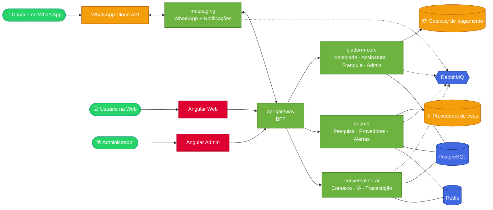

<div align="center">

# ✈️ AeroZap

### Pesquise, compare e monitore passagens aéreas — direto no **WhatsApp** 💬

*Fale como você fala. A gente acha o voo.*

<br/>


<br/>


</div>

---

## 🌟 O que é

O **AeroZap** é um SaaS para **buscar, comparar e monitorar passagens aéreas**. O canal principal é o **WhatsApp** (texto e áudio), com continuação na **Web**. Há ainda um **painel administrativo** para operar o negócio.

| | |
|---|---|
| 💬 **WhatsApp primeiro** | Converse em linguagem natural, em português ou espanhol, inclusive por áudio. |
| 🔎 **Pesquisa e comparação** | Várias fontes de voos, ofertas normalizadas e o melhor resultado em poucas linhas. |
| 🔔 **Monitoramento** | Alertas de preço entregues no WhatsApp, respeitando as regras da plataforma. |
| 🆓 **Plano Free** | 5 pesquisas por trimestre, compartilhadas entre WhatsApp e Web. |
| 💎 **Premium** | Mais pesquisas, alertas e recursos. Assinatura por gateway de pagamento. |

> ⚠️ **Transparência de preços.** Enquanto não houver uma fonte com preço ao vivo, os valores serão mostrados como **preço indicativo**, com a data da verificação e o link para o site de compra. Nunca prometemos que uma tarifa está disponível.

---

## 🧭 Arquitetura



Cinco serviços iniciais (ver [ADR-0002](docs/decisions/ADR-0002-deployables-iniciais.md)):

| 🧩 Serviço | 🎯 Responsabilidade |
|---|---|
| `api-gateway` | Entrada única, autenticação e roteamento |
| `platform-core` | Identidade, assinatura e cobrança, **franquia/uso**, administração e auditoria |
| `search` | Pesquisa de voos, integração com provedores, normalização e monitoramento |
| `conversation-ai` | Entendimento de linguagem natural, áudio e contexto da conversa |
| `messaging` | WhatsApp (entrada e saída) e notificações |

**Franquia sem corrida:** a cota é **reservada** antes da pesquisa e depois **confirmada ou liberada**, para que buscas simultâneas nunca estourem o limite ([ADR-0004](docs/decisions/ADR-0004-reserva-de-franquia.md)).

---

## 🗂️ Estrutura do repositório

```text
aerozap2027/
├── 📘 AGENTS.md  CLAUDE.md      # regras comuns da equipe de agentes
├── 🤖 agentes/                  # A0 a A8 + templates (TASK, DELIVERY REPORT, ADR)
├── ⚙️  apps/                     # api-gateway · platform-core · search · conversation-ai · messaging
├── 🎨 frontend/                 # Angular: aerozap-web · aerozap-admin
├── 📦 libs/                     # java (contratos de eventos) · typescript (design system, api-client)
├── 🏗️  infrastructure/           # docker · compose · monitoring
├── 🧪 tests/                    # e2e · carga · segurança
└── 📚 docs/                     # prd · architecture · api-contracts · decisions · runbooks · backlog
```

---

## 🤖 Equipe de agentes

O projeto é construído por uma equipe de agentes de IA coordenada pelo **CTO Master**, com o **Product Owner** (você) decidindo o que é decisão de negócio.

| Agente | Papel | Cor |
|:--:|---|:--:|
| **A0** | 🧠 CTO Master: arquitetura, ADRs, coordenação e revisão | 🟣 |
| **A1** | ☕ Backend: Java, Spring Boot, domínio e dados | 🟢 |
| **A2** | 🎨 Frontend: Angular Web e Admin, design system | 🔴 |
| **A3** | 🗣️ IA e Conversa: linguagem natural, áudio, contexto | 🟡 |
| **A4** | ✈️ Motor de Voos: provedores, normalização, monitoramento | 🔵 |
| **A5** | 💬 WhatsApp: Cloud API, templates, janelas e webhooks | 🟩 |
| **A6** | 🚀 DevOps/SRE: Docker, CI/CD, observabilidade | 🟠 |
| **A7** | 🛡️ QA e Segurança: testes, SAST, LGPD, validação | ⚫ |
| **A8** | 🧭 Produto e UX: PRD, jornadas, copy pt/es, métricas | 🩷 |

Fluxo de trabalho: `TASK → DELIVERY REPORT → revisão → DONE`, com estados `BACKLOG → READY → IN_PROGRESS → BLOCKED → REVIEW → REWORK → DONE`. Detalhes em [`agentes/README.md`](agentes/README.md) e [`AGENTS.md`](AGENTS.md).

---

## 🛣️ Roteiro

| Marco | Entrega | Estado |
|:--:|---|:--:|
| **M0** | Decisões: lista respondida, PRD v1, relatórios de provedores e ADRs 0001 a 0004 | 🟡 em fechamento |
| **M1** | Fundação: um comando sobe o ambiente; CI verde; painel de saúde; esqueleto de serviço e design system | 🟠 iniciando |
| **M2** | Conta e franquia: cadastro, login, saldo Free de 5 consultas e teste de concorrência | ⚪ |
| **M3** | Pesquisa Web: filtros, cartões e histórico, com preço indicativo rotulado | ⚪ |
| **M4** | WhatsApp: pesquisa por texto e áudio e continuação na Web | ⚪ |
| **M5** | Alertas: alerta de preço por conversa ou Web, entregue sem duplicidade | ⚪ |
| **M6** | Web e Admin: painel de usuários, planos, provedores, IA, auditoria e métricas | ⚪ |
| **M7** | Premium: checkout, recorrência, cancelamento e inadimplência | ⚪ |
| **M8** | Produção: carga, segurança e LGPD, backup restaurado, deploy com rollback e release | ⚪ |

O plano completo, com 61 tarefas, está em [`docs/architecture/plano-de-implementacao.md`](docs/architecture/plano-de-implementacao.md) e o backlog em [`docs/backlog/`](docs/backlog/README.md).

---

## 🚀 Como começar

> 🧱 O projeto está na **Fase 1 (Fundação)**. O ambiente local já sobe com um comando e o
> esqueleto de serviço Java já responde; as telas e as regras de negócio vêm nos marcos seguintes.

```bash
# 1. clonar
git clone https://github.com/marciobsb31/aerozap2027.git
cd aerozap2027

# 2. configurar variáveis locais (nunca versione o .env)
cp .env.example .env

# 3. subir o ambiente (PostgreSQL, RabbitMQ, Redis e armazenamento de objetos)
bash scripts/dev-up.sh          # e, para verificar de fato: bash scripts/dev-verify.sh

# 4. compilar e testar os módulos Java
bash scripts/build.sh           # use --sem-docker para pular os testes de integração

# 5. opcional: observabilidade (Prometheus, Grafana, Loki, Tempo, Alertmanager)
bash scripts/obs-up.sh          # e: bash scripts/obs-verify.sh
```

| Script | Para quê |
|---|---|
| `scripts/dev-up.sh` / `dev-down.sh` | sobe e derruba o ambiente local |
| `scripts/dev-verify.sh` | prova que cada serviço responde de verdade |
| `scripts/dev-check.sh` | sobe, verifica e grava tudo em `logs/dev-check.log` |
| `scripts/build.sh` | compila e testa os módulos Java |
| `scripts/ci-local.sh` | roda localmente as verificações do CI |
| `scripts/obs-up.sh` / `obs-verify.sh` / `obs-down.sh` | observabilidade |
| `scripts/probe-tags.sh` | lista versões publicadas das imagens (nenhuma tag `latest`) |

**Pré-requisitos:** JDK 21 ou mais novo (o projeto compila para 21; o alvo final é o 25, ver
[ADR-0003](docs/decisions/ADR-0003-versoes-java-e-angular.md)), Maven 3.9+, Docker e Docker Compose.
Node.js (LTS) com npm entra junto com o front-end.

Dica para quem tem pouco espaço no disco do sistema: defina `MAVEN_REPO_LOCAL` no `.env` para
manter o cache de dependências no mesmo disco do projeto.

---

## 📖 Documentação

| 📄 Documento | O que contém |
|---|---|
| [`docs/architecture/plano-de-implementacao.md`](docs/architecture/plano-de-implementacao.md) | Fases, marcos, riscos e tarefas |
| [`docs/architecture/diagnostico-tecnico.md`](docs/architecture/diagnostico-tecnico.md) | Ponto de partida e arquitetura proposta |
| [`docs/prd/PRD-v1.md`](docs/prd/PRD-v1.md) | Requisitos, jornadas e regras de negócio |
| [`docs/decisions/`](docs/decisions/) | ADRs e [decisões em aberto](docs/decisions/decisoes-em-aberto.md) |
| [`docs/architecture/convencoes.md`](docs/architecture/convencoes.md) | Branches, commits e pull requests |
| [`docs/architecture/esqueleto-servico-java.md`](docs/architecture/esqueleto-servico-java.md) | Esqueleto padrão de serviço: Outbox, DLQ, Problem Details, correlação |
| [`docs/architecture/observabilidade.md`](docs/architecture/observabilidade.md) | Métricas, logs mascarados, rastros e alertas |
| [`docs/architecture/ci.md`](docs/architecture/ci.md) | Pipelines, caches e proteções de branch |
| [`docs/architecture/relatorio-m0.md`](docs/architecture/relatorio-m0.md) | Resultado da Fase 0 |

---

## 🔐 Princípios não negociáveis

- 🔑 **Nenhum segredo no repositório.** Chaves só por variável de ambiente.
- 🌍 **pt-BR e es** em toda a experiência do usuário.
- 🛡️ **Privacidade e LGPD** desde o desenho.
- 🧾 **Pagamento só por gateway**, sem tocar em dados de cartão.
- 🔁 **Idempotência, Outbox e DLQ** nos fluxos assíncronos.
- ✅ **Nada vai para `main` sem PR, testes e revisão.**

---

<div align="center">

Feito com ☕, 🤖 e ✈️

**AeroZap** · © 2026 · Todos os direitos reservados

</div>
