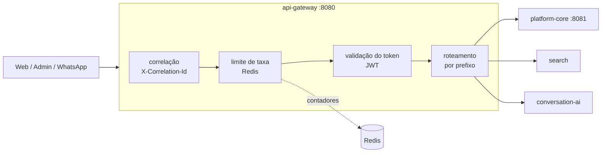

# API Gateway (borda)

> Entrega da **AZ-015** (marco M1). Contexto: DTC §4.1, [ADR-0002](../decisions/ADR-0002-deployables-iniciais.md).

A borda faz quatro coisas e **só** quatro: valida o token de entrada, limita a taxa por origem,
propaga o identificador de correlação e encaminha para o serviço da rota. Tudo o mais é dos
serviços.

Isso não é zelo estético. Regra de negócio na borda é regra em dois lugares: ela some do serviço
que deveria ser a fonte da verdade e reaparece num ponto por onde passa 100% do tráfego, onde
qualquer erro derruba a plataforma inteira. Por isso há um teste de arquitetura que **falha o
build** se o gateway passar a depender de banco, de fila ou de qualquer serviço.



## A ordem dos filtros importa

1. **Correlação** primeiro: até a resposta de erro precisa carregar o identificador, senão o
   cliente liga para o suporte sem nada em mãos.
2. **Limite de taxa** antes da autenticação: um ataque com tokens inválidos custa validação de
   assinatura a cada tentativa. Limitando antes, a borda só gasta o contador.
3. **Autenticação** depois: o que passou do limite tem o token verificado.
4. **Roteamento** por último.

## Autenticação de entrada

O gateway **valida** o token; não emite, não renova, não consulta banco. A emissão é do serviço
de identidade (AZ-020).

Na Fase 1 o token é assinado com **segredo compartilhado (HS256)**, porque ainda não existe quem
publique chaves. São verificados assinatura, validade, emissor (`iss`) e público (`aud`). Quando o
serviço de identidade existir, a troca é de configuração: em lugar do segredo, o endereço do
conjunto de chaves públicas (JWKS) — nenhuma outra parte do gateway muda.

O segredo vem de `JWT_SECRET` e **o serviço não sobe sem ele**, com pelo menos 32 caracteres
(exigência do HS256). Falhar na subida é melhor que subir aceitando qualquer coisa.

Erros saem em Problem Details (RFC 9457), com `correlationId`, no mesmo formato do resto da
plataforma: `401` sem token válido, `403` com token válido sem permissão.

Caminhos abertos: `/actuator/health`, `/actuator/info` e `/v3/api-docs`. Nada além disso.

## Limite de taxa

Janela fixa no Redis, por endereço de origem, contada por um script Lua que incrementa e marca o
vencimento **na mesma operação** — senão uma falha entre o incremento e o vencimento deixaria a
origem bloqueada para sempre.

Compartilhar o contador no Redis é o que faz o limite valer para o conjunto de instâncias, e não
por processo. Ao exceder: `429`, `Retry-After` e os cabeçalhos `X-RateLimit-Limit`,
`X-RateLimit-Remaining` e `X-RateLimit-Reset`.

**Falha em aberto, de propósito.** Se o Redis não responde, a requisição passa, com aviso no log.
Perder o limite por alguns segundos é menos grave que derrubar a borda inteira — e a borda é o
único caminho de entrada.

**Não confunda com franquia.** O limite de taxa é proteção de infraestrutura: nenhuma origem
derruba a plataforma. A franquia de consultas por plano é regra de negócio, vive no serviço de uso
([ADR-0004](../decisions/ADR-0004-reserva-de-franquia.md)) e não tem relação com este número.

Atrás de balanceador, o endereço que chega é o do balanceador. Para contar o cliente real, ligue
`server.forward-headers-strategy: framework` **e** garanta que só o balanceador fale com o
gateway: `X-Forwarded-For` é cabeçalho, qualquer um escreve o que quiser nele.

## Roteamento

Prefixo e destino, nada mais:

```yaml
aerozap:
  gateway:
    rotas:
      - prefixo: /api/plataforma
        destino: http://localhost:8081/api
```

O prefixo é da borda e **sai** antes do encaminhamento; o resto do caminho vai para o destino.
`/api/plataforma/v1/ping` chega ao serviço como `/api/v1/ping`. Assim o endereço público não
amarra o caminho interno. Quando dois prefixos casam, o mais específico ganha. Sem rota: `404`.

Método, parâmetros, cabeçalhos e corpo são repassados; os cabeçalhos ponto a ponto (RFC 9110)
ficam de fora. O gateway acrescenta `X-Correlation-Id` e os `X-Forwarded-*`. O status do serviço
volta como veio: a borda não traduz nem esconde erro de quem está atrás.

Tempos limite explícitos — 2 s para conectar, 15 s para a resposta. Sem eles, uma dependência
lenta prende as threads da borda e leva tudo junto. Esgotado o tempo: `504`.

## Como verificar

```bash
bash scripts/build.sh
bash scripts/dev-gateway-check.sh
```

O script sobe a infraestrutura, o `platform-core` e o gateway, assina um token de teste com
`openssl` e prova os três critérios de aceite: sem token é rejeitado, com token a resposta do
serviço volta pela borda com a correlação preservada, e o limite de taxa responde `429`.
Evidência em `logs/dev-gateway-check.log`.

## Limites conhecidos

- **Sem WebSocket nem streaming.** O encaminhamento lê e repassa o corpo inteiro; serve para API
  JSON. Se a borda precisar de conexão longa ou de resposta em fluxo, o caminho é trocar o
  encaminhador por Spring Cloud Gateway, mantendo filtros e rotas.
- **Limite por origem, não por usuário.** Um limite por usuário autenticado é outro filtro, a
  entrar quando houver identidade de verdade (AZ-020).
- **Uma rota configurada.** As demais entram conforme os serviços nascem.
