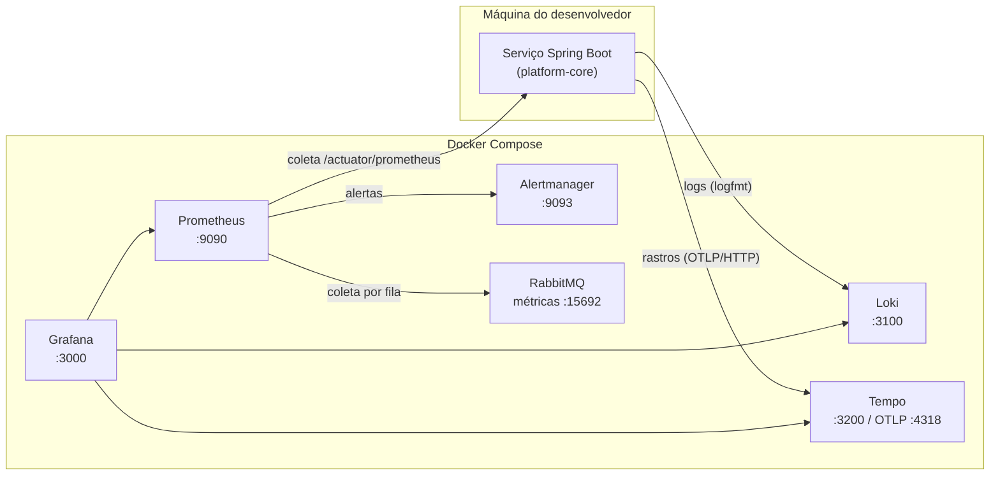

# Observabilidade

> Entrega da **AZ-013** (marco M1). Contexto: DTC §14, `agentes/06-devops-sre-engineer.md`.

Três sinais, um identificador em comum. Toda requisição recebe um **identificador de correlação**
(`X-Correlation-Id`, AZ-014) e, quando o rastreamento está ativo, um `traceId`. Métrica, log e
rastro do mesmo atendimento se encontram por esses dois campos — é isso que transforma "o sistema
está lento" em "a chamada ao provedor de voos levou 9 s nesta busca".

## Arquitetura local



O serviço roda **fora** do Docker (Maven na máquina), por isso o Prometheus o alcança por
`host.docker.internal` e o serviço alcança Loki e Tempo por `localhost`. Nenhum agente extra:
as métricas são coletadas pelo Prometheus, os logs saem pelo appender do Loki e os rastros pelo
exportador OTLP do próprio Spring Boot.

A observabilidade é **opcional e separada**: `scripts/dev-up.sh` sobe só o ambiente base
(PostgreSQL, RabbitMQ, Redis, armazenamento) e `scripts/obs-up.sh` acrescenta esta parte, que
consome memória e não é necessária para desenvolver.

## Como subir e verificar

```bash
bash scripts/dev-up.sh          # ambiente base
bash scripts/obs-up.sh          # observabilidade
SPRING_PROFILES_ACTIVE=observabilidade bash scripts/dev-service-check.sh   # serviço enviando sinais
bash scripts/obs-verify.sh      # evidência em logs/obs-verify.log
```

| Para quê | Endereço |
|---|---|
| Painel "saúde dos serviços e filas" | http://localhost:3000 → Dashboards → AeroZap |
| Consultas e alvos de coleta | http://localhost:9090 |
| Alertas disparados | http://localhost:9093 |
| Logs (também pelo Grafana) | http://localhost:3100 |
| Rastros (também pelo Grafana) | http://localhost:3200 |

Usuário e senha do Grafana vêm de `GRAFANA_USER` e `GRAFANA_PASSWORD` no `.env`. Nenhuma
credencial fica no repositório.

## Métricas

Vêm do Actuator com Micrometer, expostas em `/actuator/prometheus`. Além das padrão (JVM, HTTP,
pool de conexões, RabbitMQ no cliente), o projeto publica:

| Métrica | O que é | Por que importa |
|---|---|---|
| `aerozap_outbox_pendentes` | eventos gravados no Outbox e ainda não publicados | sinal mais direto de que a entrega de eventos parou; em operação normal volta a zero em segundos |

Os percentis por rota dependem dos baldes do histograma, ligados em `application.yml`
(`management.metrics.distribution.percentiles-histogram.http.server.requests`). Sem isso não há
p95 por rota no painel.

As métricas por fila do RabbitMQ (profundidade, DLQ) vêm do endpoint `/metrics/detailed` do
plugin `rabbitmq_prometheus`, ligado pelo arquivo
`infrastructure/monitoring/rabbitmq/enabled_plugins`.

## Logs

**Formato.** Console legível para quem está desenvolvendo; para o Loki, uma linha em `logfmt`
(`nivel=… logger=… correlationId=… traceId=… msg=…`), que o Grafana decompõe com `| logfmt`.
Com `logging.structured.format.console=logstash` o console também sai em JSON — útil quando o
serviço roda em contêiner.

**Mascaramento automático.** A biblioteca `observability-starter` registra:

- `%msgSeguro`, palavra de conversão que passa a mensagem pelo mascarador antes de qualquer
  destino (console, arquivo, Loki). O `logback-base.xml` usa `%msgSeguro` em lugar de `%msg`;
- `MascaraNoLogEstruturado`, que aplica a mesma regra a todos os valores de texto do log
  estruturado do Spring Boot, inclusive os campos do MDC.

O que é mascarado: telefone com DDI/DDD (preserva os quatro últimos dígitos), e-mail (preserva o
domínio), CPF, CNPJ, cartão, `Bearer`/`Basic` e pares do tipo `senha=`, `token=`, `api_key=`.
O que é preservado de propósito: UUID de correlação, portas, durações e contagens — mascarar
esses números cegaria o diagnóstico. As regras e os casos cobertos estão em
`MascaradorDeDadosSensiveisTest`.

**O mascaramento é rede de segurança, não permissão.** A regra do projeto continua valendo:
log registra identificador, não dado de pessoa. Em vez do telefone, registre o `conversation_id`;
em vez do e-mail, o `user_id`.

## Rastros

`spring-boot-starter-opentelemetry` exporta por OTLP/HTTP para o Tempo. No ambiente local a
amostragem é de 100% (`TRACING_AMOSTRAGEM=1.0`); em produção isso é caro e desnecessário — a
decisão de taxa entra na Fase 7, junto com o plantão. Do log para o rastro: o campo `TraceID`
aparece no detalhe de cada linha no Grafana e abre o rastro no Tempo. Do rastro para o log: o
botão de logs do Tempo filtra pelo mesmo `traceId`.

## Alertas

Regras em `infrastructure/monitoring/prometheus/alertas.yml`. No ambiente local o Alertmanager
usa um receptor sem integração: o alerta fica visível na interface e **não sai da máquina**.

| Alerta | Dispara quando | Severidade |
|---|---|---|
| `ServicoIndisponivel` | o Prometheus não coleta um serviço há 2 min | crítico |
| `TaxaDeErro5xxAlta` | mais de 5% das respostas são 5xx por 5 min | alto |
| `FilaMortaComMensagens` | qualquer mensagem em fila `*.dlq` | alto |
| `OutboxAcumulando` | mais de 100 eventos pendentes por 5 min | alto |
| `AlertaDeTeste` | sempre, de propósito | informativo |

O `AlertaDeTeste` é o que comprova o caminho Prometheus → Alertmanager sem precisar quebrar
nada: `bash scripts/obs-verify.sh` falha se ele não chegar. Para silenciá-lo, comente o grupo
`aerozap-teste` e recarregue o Prometheus.

## Retenção e consumo de disco

Ambiente local, de propósito curto: **72 h** para métricas, logs e rastros. Os dados ficam em
volumes do Docker (`prometheus-data`, `grafana-data`, `loki-data`, `tempo-data`) e
`bash scripts/obs-down.sh --apagar-dados` remove tudo.

## O que muda em produção

Esta entrega é a fundação local. Em produção (Fase 7) mudam o destino e a operação, não os
sinais: coleta gerenciada ou operada em cluster, retenção por política, amostragem de rastros
abaixo de 100%, receptores de alerta de verdade com plantão e escalonamento, e painéis por
serviço além deste painel único. O que **não** muda: nomes de métrica, mascaramento de log e o
identificador de correlação — é o que permite comparar ambientes.

## Limites conhecidos

- Só o `platform-core` é coletado; cada serviço novo entra como alvo em `prometheus.yml`.
- Sem exportador do PostgreSQL: a saúde do banco aparece pelo lado do serviço (pool de conexões).
  Um exportador dedicado entra quando houver carga real para observar.
- O envio de logs ao Loki depende do serviço estar rodando com o perfil `observabilidade`.
